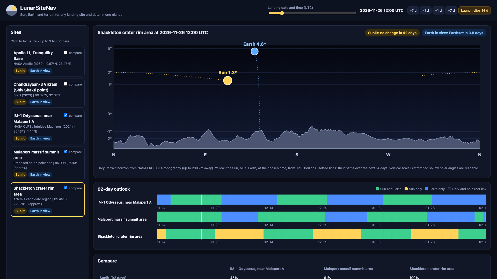

# LunarSiteNav

**Compare Moon landing sites and dates in seconds: sunlight, Earth link and real terrain.**
NASA Space Apps Challenge 2026, challenge *Lunar Landing Site Navigator*.

**Team:** Team Rimlight &nbsp;|&nbsp; NASA Space Apps Challenge 2026, Riyadh

**Live demo:** `https://<user>.github.io/lunarsitenav/` &nbsp;|&nbsp; **30 s video:** [media/LunarSiteNav_demo_30s.mp4](media/LunarSiteNav_demo_30s.mp4)



## What it does

- **Horizon panorama:** the terrain horizon around the site (from NASA LRO LOLA topography, out to 200 km, every 1 degree of azimuth) with the Sun and Earth at the chosen hour (from NASA JPL Horizons), their paths for the next 14 days, and live status: sunlit or in shadow, Earth in view or hidden, time to the next sunset or Earthset.
- **Date control:** an hourly slider over 92 days plus -7 d, -1 d, +1 d, +7 d and "Launch slips 14 d" buttons.
- **92-day outlook:** for up to three sites side by side, a colour strip in 6-hour blocks: Sun and Earth, Sun only, Earth only, or dark with no direct link.
- **Compare table:** % sunlit, % Earth in view, % both, longest darkness, longest Earth blackout, current Sun and Earth elevation with the terrain angle behind them, the longest Sun-plus-Earth window from the chosen date, and site elevation.

Sites: Apollo 11 (equatorial reference), Chandrayaan-3 Vikram (ISRO), IM-1 Odysseus (NASA CLPS), Malapert massif (approx.) and the Shackleton crater rim area (approx.). Add any site in `data/sites.json` and rerun the script.

## Example result (14 Nov 2026 to 14 Feb 2027, hourly)

| Site | Sunlit | Earth in view | Longest darkness | Longest Earth blackout |
|---|---|---|---|---|
| Apollo 11 | 51% | 100% | 356 h | 0 h |
| Chandrayaan-3 | 51% | 100% | 364 h | 0 h |
| IM-1 Odysseus | 45% | 100% | 379 h | 0 h |
| Malapert massif (approx.) | 61% | 100% | 321 h | 0 h |
| Shackleton rim area (approx.) | 100% | 54% | 0 h | 322 h |

The polar trade-off in one table: the high Shackleton rim point keeps the Sun for the whole period but loses Earth for up to about 13 days at a time, while near-side polar sites keep Earth in view but face two-week nights.

## How it works

```
data/sites.json ─► scripts/build_dataset.py ─► js/data.js ─► js/app.js
                    ├─ JPL Horizons API: Sun (10) and Earth (399) az/el from coord@301, 1 h step, 92 days
                    └─ LRO LOLA LDEM_16 (PDS): terrain horizon, great-circle march to 200 km, lunar curvature included
```

A body is visible when its elevation is above the terrain horizon at its azimuth. There is no atmosphere, so no refraction.

## Run it

Open `index.html` (no build step, no libraries). To refresh for today's date or new sites:

```bash
pip install numpy
python3 scripts/build_dataset.py   # downloads ldem_16.img (33 MB) on first run
```

## Limits

LDEM_16 is about 1.9 km per pixel, so nearby hills smaller than that are missing: sunlit fractions are upper bounds and should be checked in LROC QuickMap or Moon Trek before a real decision. "Sunlit" uses the Sun's centre; a solar array on a mast sees slightly more. Malapert and Shackleton coordinates are representative points, not surveyed landing points.

## Data

[NASA JPL Horizons](https://ssd.jpl.nasa.gov/horizons/) · [LRO LOLA gridded data, PDS Geosciences Node](https://pds-geosciences.wustl.edu/missions/lro/lola.htm) · challenge resources [LROC QuickMap](https://quickmap.lroc.asu.edu/) and [Moon Trek](https://trek.nasa.gov/moon/) for cross-checks · [CSA Moon exploration](https://www.asc-csa.gc.ca/eng/astronomy/moon-exploration/) for context.

## SI disclosure

Code was written with SI assistance (Claude, Anthropic) and reviewed by the team. The demo narration is SI-generated (Kokoro TTS) and watermarked. No NASA branding is used. Not endorsed by NASA.

## License

MIT, see [LICENSE](LICENSE).
